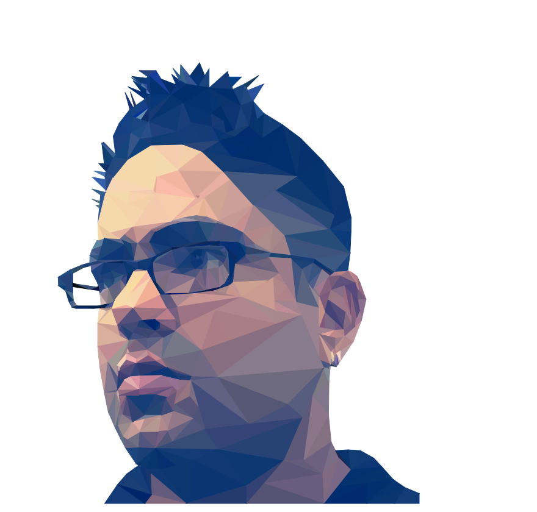
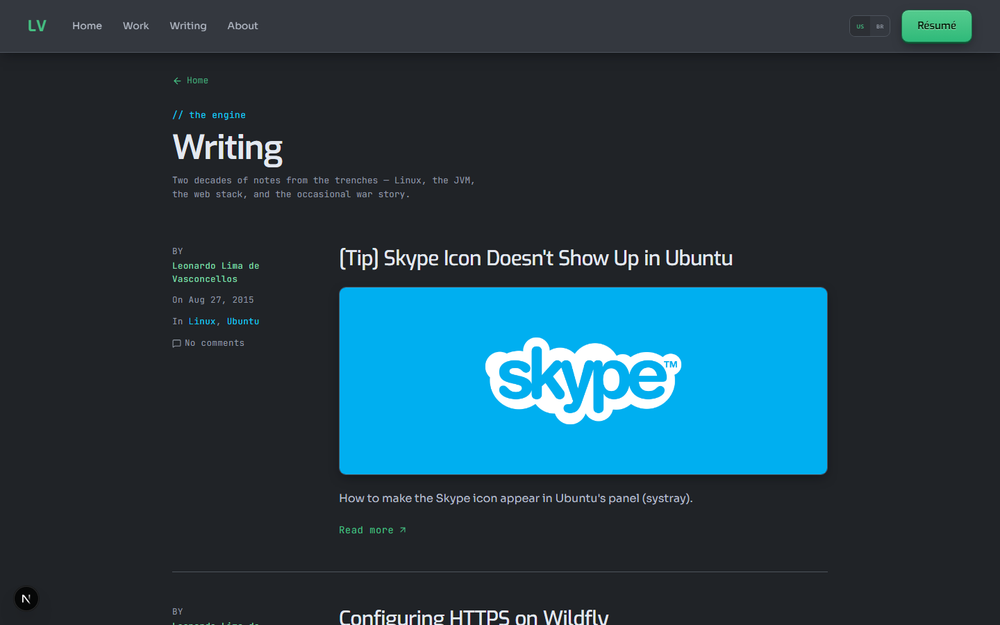
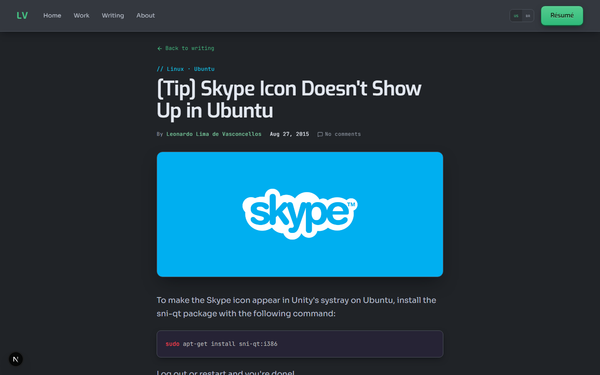
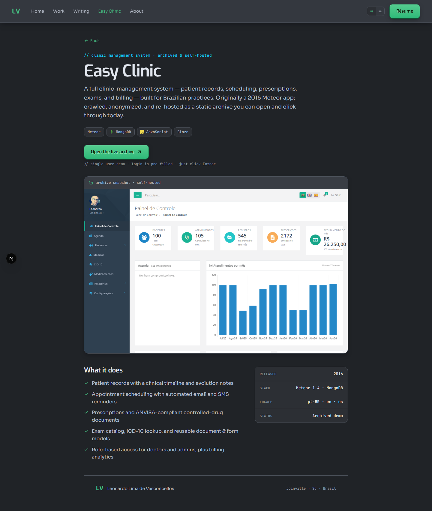
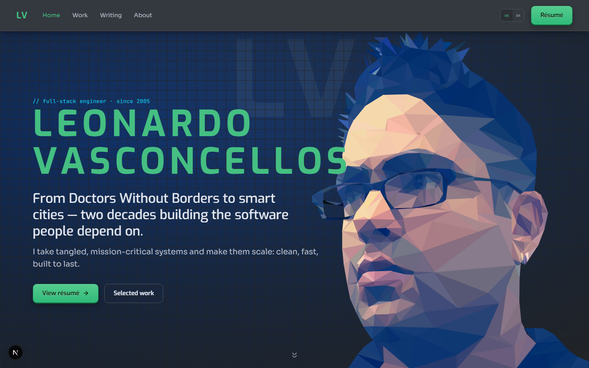

<!-- BACK TO TOP ANCHOR -->

<a id="readme-top"></a>

<!-- LOGO -->
<div align="center">
  <a href="https://leonardo-vasconcellos.vercel.app/">
    
  </a>

  <h1 align="center">Leonardo Vasconcellos — Portfolio</h1>

  <p align="center">My bilingual home base, a senior full-stack engineer: portfolio, blog and resume built around mission-critical systems where failure has real consequences.</p>

  <p align="center">// personal portfolio · leonardo vasconcellos</p>

  <br />

  <a href="https://leonardo-vasconcellos.vercel.app/">
    <strong>View it live »</strong>
  </a>
</div>

<br />

<!-- SHIELDS -->
<div align="center">

[![Creator Website][website-shield]][website-url]
[![Contributors][contributors-shield]][contributors-url]
[![Forks][forks-shield]][forks-url]
[![Issues][issues-shield]][issues-url]
[![LinkedIn][linkedin-shield]][linkedin-url]
[![Released][year-shield]][year-url]

</div>

<!-- TABLE OF CONTENTS -->
<details>
  <summary>Table of Contents</summary>
  <ol>
    <li><a href="#about-the-project">About The Project</a></li>
    <li><a href="#screenshots">Screenshots</a></li>
    <li><a href="#built-with">Built With</a></li>
    <li><a href="#getting-started">Getting Started</a></li>
    <li><a href="#learn-more-about-nextjs">Learn More about Next.js</a></li>
    <li><a href="#roadmap">Roadmap</a></li>
    <li><a href="#contributors">Contributors</a></li>
    <li><a href="#contact">Contact</a></li>
  </ol>
</details>

<!-- ABOUT THE PROJECT -->

## About The Project

[![Product Screenshot][product-screenshot]](https://leonardo-vasconcellos.vercel.app/)

<!-- PROJECT INTRO: 260 chars max -->

A bilingual (EN/PT-BR) portfolio, blog and resume for a senior full-stack engineer with two decades of mission-critical work — from Doctors Without Borders to Brazil's top-ranked smart city — hand-built as a fast, dark-only site.

<!-- END INTRO -->

This is the personal website of Leonardo Lima de Vasconcellos, a developer who has been building for the web since 2005. Over the years, he has worked on around 70 projects across five eras of web technology, from Flash and Flex to AI-assisted development. The site is organized around a simple idea: introduce the person first, then share his writing, showcase his work, and make it easy to get in touch. The homepage follows that same flow, moving from the hero section through the about page, selected projects, recent posts, client testimonials, and finally the contact section.

Writing is at the heart of the site. The blog brings together 44 posts migrated from a previous website that surpassed one million views. The original comments and images have been preserved, while the content is now available in both English and Portuguese, with localized URLs and syntax-highlighted code examples.

The portfolio features 46 projects, displayed in a compact grid that opens into detailed case studies. Some projects also have dedicated showcase pages, including Easy Clinic / Clínica Fácil and Histórias do Juca. When original screenshots were no longer available, seed-based low-poly artwork was generated to keep the archive visually consistent. A print-friendly resume completes the experience for anyone interested in working with Leonardo.

Behind the scenes, the site uses a dark-only theme and an OKLCH-based color system built around three clearly defined tiers, each with a specific purpose. Exo, Sora, and JetBrains Mono are self-hosted, and the CSS is written by hand for each component, without relying on a utility framework. Pages are server-rendered by default, and every route is pre-generated in both languages. Each page also includes its own SEO metadata, from canonical URLs and language alternates to sitemap and robots configuration, along with social sharing cards.


<!-- KEY FEATURES -->

### Key Features

- **Bilingual, search-ready publishing** — Every page, project and post exists in English and Brazilian Portuguese, with localized slugs, hreflang, canonical URLs and a sitemap — so the same content reaches clients and recruiters in both markets and gets indexed in each.
- **Legacy blog brought back to life** — A migration pipeline turned an old blog database dump — 44 posts with comments, images and broken encoding — into clean, versioned content with an English translation, so writing that once passed 1,000,000 views keeps bringing in traffic instead of disappearing.
- **Two decades of work made verifiable** — A 46-project archive with dense browsing, in-depth case studies, dedicated showcase pages and generated artwork for projects that lost their screenshots — turning discontinued work into proof a hiring manager can check in minutes.

<p align="right">(<a href="#readme-top">back to top</a>)</p>

<!-- SCREENSHOTS -->

## Screenshots

<div align="center" style="display:flex;flex-wrap:wrap;gap:8px;justify-content:center;">
  <a href="screenshots/screenshot-4-blogindex-desktop.png"></a>
  <a href="screenshots/screenshot-5-blogarticle-desktop.png"></a>
  <a href="screenshots/screenshot-6-ec-en-desktop.png"></a>
  <a href="screenshots/screenshot-1-home-desktop.png"></a>
</div>

<p align="right">(<a href="#readme-top">back to top</a>)</p>

<!-- BUILT WITH -->

## Built With

<!-- LANGUAGES -->

**Languages**

|                                                                                                                | Language   | Version |
| -------------------------------------------------------------------------------------------------------------- | ---------- | ------- |
|  | TypeScript | 5.x     |
|            | HTML       | 5       |
|              | CSS        | 3       |
|          | Node.js    | scripts |

<!-- FRAMEWORKS & LIBRARIES -->

**Frameworks & Libraries**

|                                                                                                        | Framework | Version |
| ------------------------------------------------------------------------------------------------------ | --------- | ------- |
|  | Next.js   | 16.2.7  |
|    | React     | 19.2.4  |

<p align="right">(<a href="#readme-top">back to top</a>)</p>

<!-- GETTING STARTED -->

## Getting Started

First, run the development server:

```bash
npm run dev
# or
yarn dev
# or
pnpm dev
# or
bun dev
```

Open [http://localhost:3000](http://localhost:3000) with your browser to see the result.

You can start editing the page by modifying `app/page.tsx`. The page auto-updates as you edit the file.

This project uses [`next/font`](https://nextjs.org/docs/app/building-your-application/optimizing/fonts) to automatically optimize and load [Geist](https://vercel.com/font), a new font family for Vercel.

<p align="right">(<a href="#readme-top">back to top</a>)</p>

<!-- LEARN MORE -->

## Learn More about Next.js

To learn more about Next.js, take a look at the following resources:

- [Next.js Documentation](https://nextjs.org/docs) - learn about Next.js features and API.
- [Learn Next.js](https://nextjs.org/learn) - an interactive Next.js tutorial.

You can check out [the Next.js GitHub repository](https://github.com/vercel/next.js) - your feedback and contributions are welcome!

<p align="right">(<a href="#readme-top">back to top</a>)</p>

<!-- ROADMAP -->

## Roadmap

This project repository is for archive purposes only. No new features or issues are being tracked.

<p align="right">(<a href="#readme-top">back to top</a>)</p>

<!-- CONTRIBUTORS -->

## Contributors

<a href="https://github.com/llvasconcellos2/leonardo/graphs/contributors">
  
</a>

<p align="right">(<a href="#readme-top">back to top</a>)</p>

<!-- CONTACT -->

## Contact

[Leonardo Vasconcellos - Website](https://leonardo-vasconcellos.vercel.app/) — [LinkedIn](https://www.linkedin.com/in/llvasconcellos)

<p align="right">(<a href="#readme-top">back to top</a>)</p>

<!-- MARKDOWN LINKS & IMAGES -->

[website-shield]: https://img.shields.io/badge/Creator_Website-%E2%86%97-2eba7a?style=for-the-badge
[website-url]: https://leonardo-vasconcellos.vercel.app/
[contributors-shield]: https://img.shields.io/github/contributors/llvasconcellos2/leonardo.svg?style=for-the-badge
[contributors-url]: https://github.com/llvasconcellos2/leonardo/graphs/contributors
[forks-shield]: https://img.shields.io/github/forks/llvasconcellos2/leonardo.svg?style=for-the-badge
[forks-url]: https://github.com/llvasconcellos2/leonardo/network/members
[issues-shield]: https://img.shields.io/github/issues/llvasconcellos2/leonardo.svg?style=for-the-badge
[issues-url]: https://github.com/llvasconcellos2/leonardo/issues
[linkedin-shield]: https://img.shields.io/badge/-LinkedIn-0A66C2?style=for-the-badge&logo=linkedin&logoColor=white
[linkedin-url]: https://www.linkedin.com/in/llvasconcellos
[year-shield]: https://img.shields.io/badge/Released-2026-gray?style=for-the-badge
[year-url]: #
[product-screenshot]: screenshots/screenshot-1-home-desktop.png
